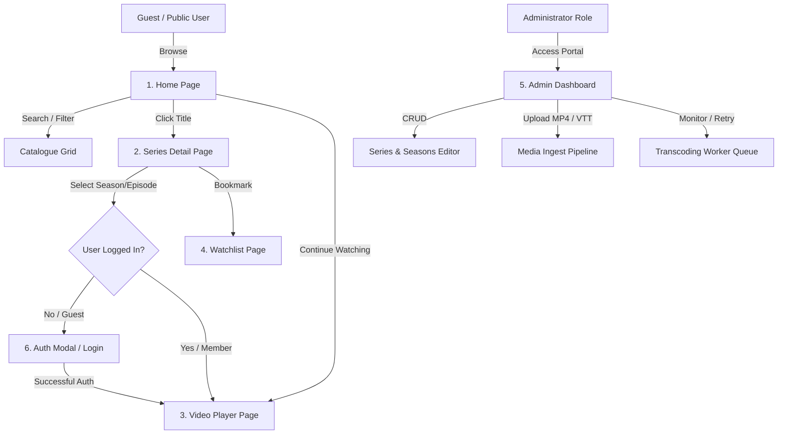

# 3SAJ Stream — UI Wireframes & Layout Specification

This directory contains the vector wireframes and user journey maps for the core screens of **3SAJ Stream**, based on the system functional requirements (FR-1 through FR-17) and non-functional requirements (NFR-1 through NFR-8).

---

## 1. Screen Architecture & Navigation Flow

---

## 2. Wireframe Inventory & Screen Breakdown

### Screen 1: Home Page & Catalogue (`home.svg`)
- **File:** [home.svg](file:///Z:/Year%204/OS/M1/docs/wireframes/home.svg)
- **Primary Roles:** Guest, Member
- **Associated Requirements:** FR-3 (Homepage & New Episodes), FR-5 (Search & Filter), NFR-2, NFR-6
- **Key Layout Zones:**
  1. **Persistent Header:** 3SAJ Stream logo, Navigation tabs (`Home`, `Browse`, `Watchlist`, `Admin Portal`), global search input with autocomplete indicator, and current user avatar / role switcher.
  2. **Spotlight Hero Banner:** Highlights a top-tier featured anime series with backdrop visual, synopsis, release year, age rating, and primary CTA buttons ("Watch Episode 1" and "+ Add to Watchlist").
  3. **Interactive Genre Filter Chips:** Pills for instant filtering across genres (Action, Sci-Fi, Fantasy, Shonen, Slice of Life).
  4. **Continue Watching Row:** Accessible to logged-in members showing partially viewed episodes with linear progress bars indicating remaining runtime (FR-10).
  5. **Popular Series Catalogue Grid:** Responsive multi-column layout showing anime posters, title overlays, and season counts.

---

### Screen 2: Series Detail & Episode List (`series-detail.svg`)
- **File:** [series-detail.svg](file:///Z:/Year%204/OS/M1/docs/wireframes/series-detail.svg)
- **Primary Roles:** Guest, Member
- **Associated Requirements:** FR-4 (Series details & episode list), FR-9 (Watchlist toggle), FR-12
- **Key Layout Zones:**
  1. **Series Header & Metadata Banner:** High-resolution vertical poster, localized title, release year, age classification, studio credits, genre chips, and comprehensive plot synopsis.
  2. **Call-to-Action Bar:** "Play Episode 1" direct streaming trigger and stateful "Add to Watchlist" bookmark button.
  3. **Season Selector Tabs:** Tabbed navigation enabling users to switch between Season 1, Season 2, and OVAs.
  4. **Episode List Cards:** Tabular/list format displaying episode thumbnail, index number, runtime in minutes, episode title, synopsis preview, and instant "Play" action.

---

### Screen 3: Video Player & Controls (`video-player.svg`)
- **File:** [video-player.svg](file:///Z:/Year%204/OS/M1/docs/wireframes/video-player.svg)
- **Primary Roles:** Member
- **Associated Requirements:** FR-6 (HTML5 playback & controls), FR-7 (WebVTT subtitles), FR-8 (Resume position), NFR-1, NFR-7
- **Key Layout Zones:**
  1. **Theater Viewport (16:9 Aspect Ratio):** Optimized dark canvas with centered video content and anti-glare styling.
  2. **Custom Overlay Controls:**
     - Interactive scrubber progress bar with buffered and elapsed time indicators.
     - Play/Pause toggle, Skip -10s, Skip +10s.
     - Volume control with mute toggle and slider.
     - Timestamp display (`14:20 / 23:45`).
     - Subtitle Track popover (`CC`) allowing toggling between English (WebVTT), Japanese, Spanish, and Subtitles Off.
     - Quality resolution selector (`1080p`) and Fullscreen toggle (`F`).
  3. **Up Next / Playlist Sidebar:** Right-hand vertical rail showing upcoming episodes in the current season with auto-play indicator.
  4. **Episode Metadata Section:** Title, release date, and detailed episode plot summary beneath the video viewport.

---

### Screen 4: Watchlist & Continue Watching (`watchlist.svg`)
- **File:** [watchlist.svg](file:///Z:/Year%204/OS/M1/docs/wireframes/watchlist.svg)
- **Primary Roles:** Member
- **Associated Requirements:** FR-8, FR-9, FR-10
- **Key Layout Zones:**
  1. **Header & Sub-tabs:** Quick toggle between "My Watchlist", "Continue Watching", and "Watch History".
  2. **Continue Watching Shelf:** Visual cards displaying thumbnail, episode marker, progress bar percentage, and one-click "Resume ▶" button.
  3. **Saved Series Grid:** Full grid of bookmarked series with quick-remove icon (`✕`) and direct navigation to series stream.

---

### Screen 5: Admin Management & Transcoding Queue (`admin-dashboard.svg`)
- **File:** [admin-dashboard.svg](file:///Z:/Year%204/OS/M1/docs/wireframes/admin-dashboard.svg)
- **Primary Roles:** Administrator (Restricted Access)
- **Associated Requirements:** FR-11, FR-12, FR-13, FR-14, FR-15, FR-16, FR-17
- **Key Layout Zones:**
  1. **Top Metric Cards:** High-level summary of active series count, transcoded episodes, active encoding jobs, and error alerts.
  2. **Series CRUD Table:** Table view of all existing series with columns for Title, Genres, Release Year, Season/Episode counts, publication status, and Edit/Delete/Add Episode actions.
  3. **Media Upload Toolbar:** Trigger for uploading MP4 video files with format/size validation and WebVTT subtitle tracks.
  4. **Transcoding Worker Tasks Table:** Job status tracker showing Job ID, target episode, file format, subtitle associations, status badges (`Processing 68%`, `Failed`, `Ready with Thumbnail`), and direct "Retry Job ↺" action button for failed jobs (FR-17).

---

### Screen 6: Authentication & Role Switcher Modal (`auth-modal.svg`)
- **File:** [auth-modal.svg](file:///Z:/Year%204/OS/M1/docs/wireframes/auth-modal.svg)
- **Primary Roles:** Guest, Member, Evaluator / Grader
- **Associated Requirements:** FR-1 (Registration), FR-2 (Login / Logout), NFR-4
- **Key Layout Zones:**
  1. **Card Container:** Clean centered modal with dark overlay backdrop.
  2. **Sign In / Register Tabs:** Seamless switching between login credentials and new account creation.
  3. **Input Fields:** Email/Username and masked Password fields with inline validation and password visibility toggle.
  4. **One-Click Demo Switcher:** Dedicated developer/evaluator toolbar allowing instantaneous switching between Guest, Member, and Admin roles without manual typing.

---

## 3. Responsive Breakpoints Specification (NFR-7)

| Device / Viewport | Width Range | Layout Adaptation Strategy |
| :--- | :--- | :--- |
| **Mobile** | `360px – 640px` | Single-column cards, collapsible burger menu, stacked video player, bottom-sheet subtitle selection. |
| **Tablet** | `641px – 1024px`| 2 to 3 column series grid, compact playlist below player, collapsed admin sidebar. |
| **Desktop / Full HD** | `1025px – 1920px`| 4 to 6 column series grid, side-by-side player and playlist, full admin dual-column layout. |
